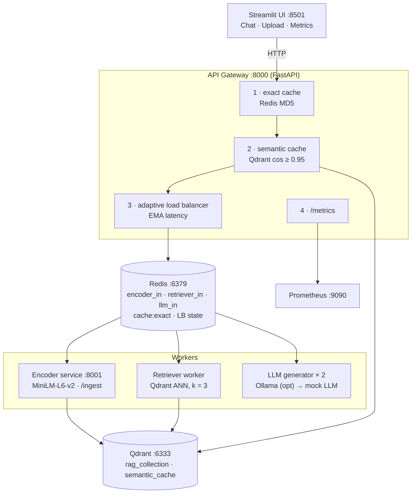
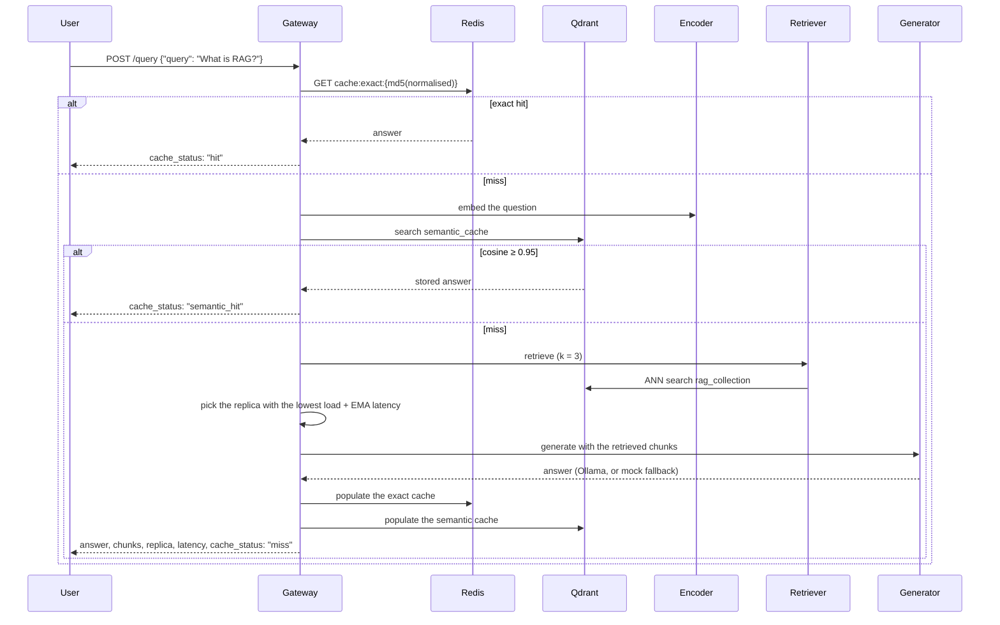

# RL-Optimized Disaggregated RAG

**A fully disaggregated Retrieval-Augmented Generation system — encoder, retriever and generators as separate workers behind a gateway with two cache layers and an adaptive load balancer.**

[](docker-compose.yml)
[](services/api_gateway/app.py)
[](services/retriever_service/worker.py)
[](services/api_gateway/app.py)
[](rag-optimizer/prometheus/prometheus.yml)
[](rag-optimizer/streamlit_app/app.py)

Each stage of the RAG pipeline runs as its own service and talks over Redis
queues, so the expensive parts scale independently. Real MiniLM embeddings,
Qdrant ANN search, an optional Ollama LLM with a mock fallback, exact and
semantic caches, live document ingestion, and a Streamlit dashboard that shows
exactly which chunks an answer came from.

---

## Contents

| Section | |
|---|---|
| [What it does](#what-it-does) | The feature surface, by area |
| [Architecture](#architecture) | Gateway, workers, stores |
| [How a question travels](#how-a-question-travels) | Exact cache, semantic cache, pipeline |
| [Quick start](#quick-start) | One `docker-compose up` |
| [Configuration](#configuration) | Ollama, environment, ports |
| [Benchmarks and metrics](#benchmarks-and-metrics) | Scenarios, outputs, PromQL |
| [Design decisions](#design-decisions) | Caching, chunking, load balancing |
| [Repository layout](#repository-layout) | Where things live |
| [Documentation](#documentation) | API and troubleshooting |
| [Team](#team) | Who built it |

---

## What it does

| Area | Capabilities |
|---|---|
| **Embeddings** | sentence-transformers `all-MiniLM-L6-v2` (dim 384) behind `/encode`, `/encode_batch`, `/ingest` |
| **Retrieval** | Qdrant ANN cosine search, k = 3, with source, score and chunk index returned |
| **Generation** | Two generator workers; Ollama `llama3.2` when configured, a keyword-based mock LLM otherwise |
| **Caching** | Redis exact cache (normalised MD5, TTL 3600 s) and Qdrant semantic cache (cosine ≥ 0.95) |
| **Load balancing** | Lowest `active_connections + EMA_latency_ms / 1000` wins, state shared in Redis |
| **Ingestion** | PDF, TXT and Markdown upload; recursive chunking (500 chars, 100 overlap); idempotent SHA256 point IDs |
| **Observability** | Prometheus metrics for requests, latency, cache hits, active jobs, replica load, ingested chunks |
| **Dashboard** | Streamlit chat with chunk transparency, document upload, metrics and health views |
| **Benchmarks** | Cache-off / exact / semantic scenarios across worker counts, with P50/P95/P99 and RPS |

---

## Architecture



---

## How a question travels



---

## Quick start

```bash
# 1 — gateway, encoder, retriever, two generators, mock LLM, Redis, Qdrant, Prometheus, UI
docker-compose up -d --build

# 2 — the dashboard
open http://localhost:8501      # macOS · use `start` on Windows

# 3 — or straight at the API
curl -s -X POST http://localhost:8000/query -H "Content-Type: application/json" \
  -d '{"query": "What is RAG?"}' | jq .
```

The first start downloads the embedding model (~80 MB) and ingests the seed
corpus — allow about 60 seconds for the encoder to report healthy. The seed
corpus covers RAG, vector search, Redis, Qdrant, FastAPI, Prometheus,
Kubernetes and the CAP theorem, so answers are meaningful immediately.

---

## Configuration

### A real LLM with Ollama

```bash
# Option A — the Docker profile
docker-compose --profile ollama up -d --build
docker exec -it $(docker ps -qf name=ollama) ollama pull llama3.2      # ~2 GB, once
#   uncomment OLLAMA_BASE_URL=http://ollama:11434 and OLLAMA_MODEL=llama3.2 in docker-compose.yml
docker-compose up -d --no-deps llm_generator_1 llm_generator_2

# Option B — Ollama on the host
ollama pull llama3.2
#   set OLLAMA_BASE_URL=http://host.docker.internal:11434
```

Workers **always fall back to the mock LLM** if Ollama is unreachable.

### Environment

| Service | Variable | Default | Description |
|---|---|---|---|
| `api_gateway` | `EXACT_CACHE_ENABLED` · `EXACT_CACHE_TTL` | `true` · `3600` | Redis exact cache |
| `api_gateway` | `SEMANTIC_CACHE_ENABLED` · `SEMANTIC_CACHE_THRESHOLD` | `true` · `0.95` | Qdrant semantic cache |
| `api_gateway` | `ENCODER_SERVICE_URL` | `http://encoder_service:8000` | Encoder endpoint |
| `encoder_service` | `EMBEDDING_MODEL` | `all-MiniLM-L6-v2` | Hugging Face model id |
| `encoder_service` | `CHUNK_SIZE` · `CHUNK_OVERLAP` | `500` · `100` | Chunking |
| `llm_generator_*` | `OLLAMA_BASE_URL` · `OLLAMA_MODEL` | _(empty)_ · `llama3.2` | Ollama, disabled when empty |
| `llm_generator_*` | `USE_MOCK_FALLBACK` | `true` | Fall back to the mock LLM |
| All | `QDRANT_HOST` · `QDRANT_COLLECTION` | `qdrant` · `rag_collection` | Vector store |

### Ports

| Service | Port |
|---|---|
| Streamlit UI | 8501 |
| API Gateway | 8000 |
| Encoder service | 8001 |
| Mock LLM | 8888 |
| Qdrant | 6333 |
| Redis | 6379 |
| Prometheus | 9090 |
| Ollama (optional) | 11434 |

---

## Benchmarks and metrics

```bash
# default: 20 questions × 3 scenarios × 3 worker counts, concurrency 4
python benchmarks/run_benchmark.py

# custom
python benchmarks/run_benchmark.py --url http://localhost:8000 \
    --requests 50 --concurrency 8 --workers 1,2,4

# without the /admin/cache toggle
python benchmarks/run_benchmark.py --skip-cache-toggle
```

| Scenario | What it measures |
|---|---|
| Exact cache OFF | Every request runs the full pipeline |
| Exact cache ON | Repeated questions served from Redis |
| Semantic cache ON | Near-duplicate questions served from Qdrant |

Results land in `benchmarks/results/`: `report.md` (P50/P95/P99, RPS, cache hit
%), `results.csv` (per request) and `summary.json`.

| Metric | PromQL |
|---|---|
| Request rate | `rate(api_gateway_queries_total[30s])` |
| P95 latency | `histogram_quantile(0.95, rate(api_gateway_query_latency_seconds_bucket[30s]))` |
| Exact cache hit rate | `cache_hits_total / (cache_hits_total + cache_misses_total)` |
| Semantic cache hits | `rate(semantic_cache_hits_total[1m])` |
| Active jobs · worker load | `api_gateway_active_jobs` · `api_gateway_replica_load` |
| Worker latency · ingested chunks | `worker_avg_latency_ms` · `ingestion_chunks_total` |

---

## Design decisions

**Disaggregate the pipeline.** Encoding, retrieval and generation are separate
workers fed by Redis list queues (`encoder_in`, `retriever_in`, `llm_in`), so the
generator — the slow, expensive stage — can be replicated on its own.

**Two caches, cheapest first.** An identical question never touches the
pipeline: it is normalised, MD5-hashed and answered from Redis. A
near-identical one is answered from Qdrant's `semantic_cache` when cosine
similarity is at least 0.95. Both are populated on every pipeline completion.

**Balance on load and latency, not round-robin.** Each replica scores
`active_connections + EMA_latency_ms / 1000`, with the EMA updated after every
job at α = 0.2. Counters live in Redis so every gateway process sees the same
picture.

**Re-ingestion is idempotent.** Point IDs are `SHA256(source::chunk_index) % 2^63`,
so uploading the same document again overwrites its chunks instead of
duplicating them. Chunks split recursively on `\n\n`, `\n`, sentence ends,
`;`, `,` and spaces, at most 500 characters with a 100-character overlap.

**Degrade, don't fail.** Without Ollama the mock LLM answers; the dashboard
shows which backend produced each answer (`llm_backend`).

**Show the evidence.** Every answer comes with the chunks it was built from —
text, score, source and index — and the replica that served it.

---

## Repository layout

```
.
├── services/
│   ├── api_gateway/          entry point: caching, load balancing, metrics
│   ├── encoder_service/      embeddings, /ingest, chunking
│   ├── retriever_service/    Qdrant ANN search worker
│   ├── llm_generator/        Ollama + mock LLM worker
│   └── mock_llm/             keyword-based fallback LLM
├── rag-optimizer/
│   ├── streamlit_app/        three-tab dashboard
│   ├── prometheus/           scrape config
│   └── locust/               load-test file
├── benchmarks/               benchmark suite and generated results
├── utils/                    standalone ingestion script
└── data/corpus.txt           seed knowledge base
```

---

## Documentation

<details>
<summary><b>API</b></summary>

```bash
curl -s -X POST http://localhost:8000/query  -H "Content-Type: application/json" -d '{"query": "What is RAG?"}'
curl -s -X POST http://localhost:8000/ingest -H "Content-Type: application/json" -d '{"text": "Your document text here.", "source": "my-doc.txt"}'
curl -s http://localhost:8000/health
curl -s http://localhost:8000/metrics | grep -v "^#"
```

```json
{
  "job_id": "abc123",
  "query": "What is RAG?",
  "answer": "Retrieval-Augmented Generation...",
  "latency_ms": 142.7,
  "selected_replica": "replica-1",
  "cache_status": "hit",
  "retrieved_chunks": [
    {"text": "...", "score": 0.921, "source": "corpus.txt", "chunk_index": 3}
  ],
  "llm_backend": "ollama:llama3.2"
}
```

</details>

<details>
<summary><b>Troubleshooting</b></summary>

| Symptom | Fix |
|---|---|
| Encoder takes 60 s to start | First-run model download — wait for the health check |
| All answers are generic | The corpus is not ingested yet — check encoder logs for `/ingest` |
| `cache_status` always `"miss"` | Cache env vars may be `false` in `docker-compose.yml` |
| Ollama answers not appearing | Set `OLLAMA_BASE_URL` and run `ollama pull llama3.2` |
| `503 Service Unavailable` | Workers not ready yet — `docker-compose ps` |
| Qdrant collection not found | The encoder creates it on startup — check its logs |
| Prometheus shows no data | `rag-optimizer/prometheus/prometheus.yml` must scrape `api_gateway:8000` |

```bash
docker-compose logs -f api_gateway encoder_service llm_generator_1
docker-compose down -v && docker-compose up -d --build      # reset everything
```

</details>

---

## Team

| Member | Focus |
|---|---|
| **Harsh Pandya** | Initial services, utilities, load testing |
| **Guru R Bharadwaj** | Gateway and worker rework, dashboard, benchmark suite, bug fixes |
| **Harsha Kamaraj** | Contributor |
| **Gagandeep** | Contributor |
